# Theseus 项目全景思维导图

> 项目全景思维导图 · 基线 2026-11-21 · fda4570 / 7448de9
>
> 交互版：[theseus-mindmap.html](./theseus-mindmap.html)（离线可用）
> 数据源：`mindmap-data.js`；Mermaid 与大纲由 `build-md.mjs` 生成，不要手改生成段落。
> 维护：改 `mindmap-data.js` 后执行 `node doc/map/build-md.mjs`。

## Mermaid 源图

> GitHub、VS Code 与新版本 Mermaid 可直接渲染 mindmap；若渲染器版本较旧，打开 HTML 版。

```mermaid
mindmap
  root((Theseus 校内 OJ 算法服务平台))
    n1[定位与目标]
      n2[校内单租户在线算法服务平台]
      n3[刷题 · 判题 · 作业 · 匹配 · 论坛 · 防作弊]
      n4[三角色互斥：学生 / 教师 / 管理员]
      n5[设计原则]
        n6[简单但完整：模块化单体]
        n7[PostgreSQL 是唯一事实来源]
        n8[判题 / 邮件 / 扫描异步化]
        n9[最小权限与资源归属]
        n10[防作弊重证据，人工复核]
      n11[成功标准]
        n12[判题 P95 ≤ 15 秒出终态]
        n13[隐藏用例零泄露]
        n14[教学闭环可完整演示]
        n15[单机可重启恢复]
      n16[非目标]
        n17[多学校 SaaS]
        n18[支付 / 证书]
        n19[原生 App]
        n20[微服务拆分]
    n21[用户与角色]
      n22[学生]
        n23[题库浏览 / 运行 / 提交]
        n24[加入组织，完成作业]
        n25[4 人匹配与限时赛事]
        n26[论坛 / 面经 / 笔记 / 错题本]
      n27[教师]
        n28[管理自有组织与学生]
        n29[组题 / 布置作业 / 批改]
        n30[个人出题交管理员审核]
        n31[可用题库 / 论坛 / 通知]
      n32[管理员]
        n33[题目审核与用户角色管理]
        n34[论坛 / 通知 / 赛事 / Plus]
        n35[审计日志与平台监控]
        n36[不进入教学数据]
      n37[角色互斥]
        n38[每账号仅一个角色]
        n39[不叠加、不继承]
        n40[认证每次读取数据库]
    n41[总体架构]
      n42[前端]
        n43[Vue 3 + TypeScript + Vite]
        n44[Pinia · Vue Router · Monaco]
        n45[页面路由懒加载]
      n46[接入层]
        n47[Nginx 静态资源与 /api 反代]
        n48[安全响应头与 CORS 白名单]
      n49[API 进程]
        n50[Rust + Axum 0.8 模块化单体]
        n51[REST + WebSocket Hub]
        n52[鉴权 / 业务编排 / 审计]
        n53[进程内后台任务]
          n54[邮件 outbox 投递]
          n55[匹配与赛事结算]
          n56[Plus 到期提醒]
          n57[实时消息扇出]
          n58[判题超时回收]
      n59[异步 Worker]
        n60[judge_worker：判题与运行]
        n61[anticheat_worker：相似度扫描]
        n62[lsp_gateway：语义补全网关]
      n63[数据与中间件]
        n64[PostgreSQL：唯一事实来源]
        n65[Redis：Streams / 缓存 / 限流 / 匹配池 / PubSub]
        n66[SMTP + outbox：验证与通知邮件]
      n67[沙箱]
        n68[Docker / gVisor]
        n69[非 root · 只读根 · 无网络]
        n70[CPU / 内存 / PID / 时间 / 输出限制]
    n71[身份与账号]
      n72[注册 / 登录 / JWT]
      n73[三角色互斥认证]
      n74[邮箱验证与密码找回]
      n75[一次性令牌 + outbox 投递]
      n76[单设备登录]
        n77[登录递增 token_version]
        n78[旧 JWT 立即失效]
        n79[前端提示修改密码]
      n80[GitHub OAuth]
        n81[只绑定已有账号]
        n82[不自动建号]
        n83[未配置凭据时入口隐藏]
      n84[注销与匿名化]
      n85[设置中心与偏好同步]
    n86[题库 · 判题 · 练习]
      n87[题库]
        n88[1000 题]
        n89[新增 800 题：300 简单 / 340 中等 / 160 困难]
        n90[标签 / 难度 / 搜索 / 统计]
        n91[隐藏用例与公开示例]
      n92[个人出题与审核]
        n93[学生 / 教师提交，落库 pending]
        n94[管理员审核后进入题库]
        n95[审核状态机]
          n96[draft → pending → approved → archived]
          n97[rejected 可退回 draft]
      n98[判题]
        n99[POST /api/runs 运行]
        n100[POST /api/submissions 提交]
        n101[Redis Streams 异步队列]
        n102[Docker 沙箱执行]
        n103[首个失败用例与提交快照]
        n104[WebSocket 推送 + 2 秒轮询兜底]
        n105[终态：AC / WA / TLE / MLE / RE / CE]
      n106[练习与学习]
        n107[首页学习工作台]
        n108[继续学习 / 随机一题 / 最近活动]
        n109[错题本与待复习]
        n110[收藏与学习分析]
        n111[跨设备草稿，Mod+S 即存]
      n112[一题多解]
        n113[每题最多 5 份独立解法]
        n114[本机与服务端双模式]
        n115[登录后合并游客解法]
      n116[题目笔记与题解]
        n117[私有 Markdown 笔记]
        n118[题解与讨论区复用论坛]
    n119[匹配 · 赛事 · 段位]
      n120[4 人实时匹配]
      n121[超时降级]
        n122[3 分钟降为 3 人房]
        n123[5 分钟降为 2 人房]
      n124[段位分与比赛结算]
      n125[断线重连]
        n126[10 秒心跳]
        n127[30 秒标记断线]
        n128[120 秒冻结成绩]
        n129[全员断线取消排位赛]
      n130[限时赛事]
        n131[公开 / 邀请 / 外部链接报名]
        n132[名额 / 组织 / 年级范围]
        n133[赛事内答题与排行榜]
        n134[赛事申诉与成绩 CSV]
        n135[校园墙公告同步]
      n136[赛季与排位]
        n137[赛季软重置回 1000 附近]
        n138[排位榜与赛季榜]
        n139[赛季奖励未开始]
    n140[组织 · 作业 · 批改]
      n141[组织]
        n142[创建 / 归档 / 邀请码]
        n143[成员添加 / 移除 / 退出]
        n144[CSV 批量导入学生]
      n145[作业生命周期：draft → scheduled → active → closed → archived]
      n146[作业策略]
        n147[迟交宽限与按天扣分]
        n148[每题提交次数]
        n149[三种计分策略]
        n150[成绩可见时机]
        n151[补交 / 免修]
        n152[解析独立发布]
      n153[批改]
        n154[自动判题分]
        n155[教师手动分与评语]
        n156[整体评语与批改台]
        n157[截止后发布成绩]
      n158[成绩与统计]
        n159[成绩申诉]
        n160[作业统计报表]
        n161[成绩 CSV 导出]
        n162[站内信与邮件通知]
    n163[防作弊]
      n164[预防]
        n165[摄像头与屏幕共享授权]
        n166[切屏 / 粘贴事件记录]
        n167[粘贴内容初筛]
      n168[检测]
        n169[token 归一化 + winnowing 指纹]
        n170[同作业 / 同题 / 同语言扫描]
        n171[similarity_pairs 相似度对]
      n172[复核]
        n173[超阈值生成教师报告]
        n174[教师确认或排除]
        n175[确认时可选该题判 0]
        n176[管理员负载均衡分派]
      n177[处罚与申诉]
        n178[确认作弊扣 25 信誉分]
        n179[取消本场成绩并重排]
        n180[低于 40 禁排位 / 赛事 / 论坛]
        n181[负分自动封号并入邮箱黑名单]
        n182[学生可申诉一次并恢复成绩]
        n183[每日签到 +0.1 信誉分]
      n184[边界]
        n185[信号只生成报告]
        n186[不自动定罪]
        n187[全程审计留痕]
    n188[论坛 · 面经]
      n189[论坛 / 校园墙]
        n190[发帖 / 评论 / 点赞 / 收藏]
        n191[引用题目与举报]
        n192[管理员审核与禁言]
      n193[面经板块]
        n194[board 为 interview 的帖子]
        n195[Plus / 管理员 / 作者可见]
        n196[正文只收题目，答案写评论]
        n197[公司 / 岗位结构化筛选]
        n198[阅读数与最佳答案]
        n199[面试类型]
          n200[technical / hr / algorithm / manager]
        n201[HR 模板 Wiki]
      n202[题目讨论]
        n203[按 problem_id 聚合帖子]
        n204[热度 / 最新排序]
        n205[竞赛答题页隐藏入口]
    n206[通知 · 商店 · 管理端]
      n207[通知]
        n208[站内信 / 未读数 / 通知中心]
        n209[管理员按用户 / 角色 / 全站发送]
        n210[邮件类别偏好与投递]
        n211[WebSocket 实时推送]
      n212[商店 Plus]
        n213[学生与教师可见，管理员不显示]
        n214[申请 → 管理员审核]
        n215[有效期 1–3650 天]
        n216[有效期内可提前续费并顺延]
        n217[到期前 7 / 3 / 1 天提醒]
        n218[权益：面经板块 + Plus 标识]
      n219[管理端]
        n220[用户 / 角色 / 题目审核]
        n221[论坛 / 通知 / 赛事 / Plus]
        n222[赛季 / 赛事申诉]
        n223[审计日志筛选与 CSV 导出]
        n224[判题配置与队列监控]
    n225[AI · LSP · 设置]
      n226[AI 助手]
        n227[仅 Plus 与管理员可用]
        n228[OpenAI 兼容接口]
        n229[只发送题面与公开示例]
        n230[不发送隐藏用例]
        n231[每日额度 ai_usage]
        n232[作业级开关]
        n233[Markdown + KaTeX]
      n234[语义补全]
        n235[clangd 与 pyright]
        n236[一次性票据 + WebSocket]
        n237[仅 C++ 与 Python]
        n238[比赛模式禁用]
      n239[设置中心]
        n240[外观 / 编辑器 / 快捷键]
        n241[题目默认值与分页]
        n242[user_preferences 跨设备同步]
        n243[未登录回退本机设置]
    n244[数据模型]
      n245[身份]
        n246[users / oauth_identities]
        n247[user_preferences]
      n248[题库与判题]
        n249[problems / judge_cases]
        n250[submissions / problem_solutions]
        n251[problem_notes / problem_drafts]
      n252[教学]
        n253[classes / class_members]
        n254[assignments / assignment_submissions]
        n255[assignment_grade_appeals]
      n256[竞赛]
        n257[contests / contest_registrations]
        n258[seasons / season_ratings]
      n259[社区]
        n260[forum_posts / forum_comments]
        n261[interview_templates]
      n262[平台]
        n263[notifications / audit_logs]
        n264[plus_applications / plus_memberships]
        n265[similarity_pairs / wrong_problem_dismissals]
    n266[接口与事件]
      n267[REST /api/*]
        n268[接口契约见 backend_api.md]
        n269[统一错误码与鉴权]
      n270[WebSocket]
        n271[POST /api/ws/ticket 一次性票据]
        n272[GET /api/ws]
        n273[notification.new]
        n274[match.found]
        n275[submission.result]
      n276[异步任务]
        n277[Redis Streams 判题队列]
        n278[outbox 邮件投递]
        n279[相似度扫描]
      n280[健康与指标]
        n281[/healthz /readyz]
        n282[/metrics]
      n283[限流与幂等]
        n284[固定窗口限流]
        n285[登录失败锁定]
        n286[Retry-After]
    n287[安全 · 运维 · 交付]
      n288[安全]
        n289[三角色最小权限]
        n290[CORS 白名单与安全响应头]
        n291[Markdown / 模板 XSS 清洗]
        n292[沙箱隔离与资源限制]
        n293[审计追加式留痕]
      n294[性能]
        n295[首页并行查询]
        n296[复合索引与慢查询采集]
        n297[k6 读路径压测]
      n298[可观测]
        n299[Prometheus / Alertmanager / Grafana]
        n300[结构化日志与 Worker 心跳]
        n301[判题积压 / 死信告警]
      n302[部署]
        n303[Docker Compose 单机]
        n304[Nginx 反代与 TLS 手册]
        n305[备份 / 恢复 / update.sh]
      n306[CI/CD]
        n307[fmt / clippy / test / build]
        n308[cargo audit / npm audit]
        n309[GHCR 完整 SHA 镜像]
        n310[首次远程 CI 待验证]
    n311[路线与当前状态]
      n312[P0 刷题 · 判题 · 论坛 · 通知 — 已完成]
      n313[P1 教学闭环 — 已完成]
      n314[P2 通知与防作弊 — 已完成]
      n315[P3 匹配与赛事 — 部分完成]
        n316[匹配 / 段位 / 赛事 / 赛季已上线]
        n317[赛季奖励与定时切换未开始]
      n318[P4 治理 · 观测 · 部署 — 部分完成]
        n319[部署 / 观测 / CI 已上线]
        n320[CD 与多实例未开始]
      n321[P5 AI 与移动端优化 — 部分完成]
      n322[当前阻塞]
        n323[CI 结果待确认]
        n324[服务器部署待执行]
        n325[cargo audit 与 npm audit 本地未复跑]
      n326[关键指标]
        n327[题库 1000 题]
        n328[后端 163 + 5 tests]
        n329[前端 build 通过]
        n330[冒烟脚本 smoke_*.sh]
    n331[文档与代码地图]
      n332[文档入口]
        n333[doc/README.md 索引]
        n334[doc/STATUS.md 当前状态]
        n335[doc/总体设计.md 设计基线]
        n336[doc/backend_api.md 接口契约]
        n337[doc/AGENTS.md 维护约定]
      n338[归档与报告]
        n339[doc/archive/YYYYMMDD/]
        n340[doc/reports/]
      n341[素材]
        n342[doc/interview/ 面经原始 Markdown]
        n343[doc/mockups/ 页面原型]
        n344[doc/map/ 本思维导图]
      n345[代码入口]
        n346[backend-rust/ API · Worker · LSP]
        n347[frontend-vue/ Vue 3 SPA]
        n348[deploy/ Compose 与运维脚本]
      n349[验证入口]
        n350[dev.sh 本地全栈]
        n351[update.sh 增量部署]
        n352[smoke_*.sh 接口冒烟]
```

## 纯文本大纲

- 定位与目标
  - 校内单租户在线算法服务平台
  - 刷题 · 判题 · 作业 · 匹配 · 论坛 · 防作弊
  - 三角色互斥：学生 / 教师 / 管理员
  - 设计原则
    - 简单但完整：模块化单体
    - PostgreSQL 是唯一事实来源
    - 判题 / 邮件 / 扫描异步化
    - 最小权限与资源归属
    - 防作弊重证据，人工复核
  - 成功标准
    - 判题 P95 ≤ 15 秒出终态
    - 隐藏用例零泄露
    - 教学闭环可完整演示
    - 单机可重启恢复
  - 非目标
    - 多学校 SaaS
    - 支付 / 证书
    - 原生 App
    - 微服务拆分
- 用户与角色
  - 学生
    - 题库浏览 / 运行 / 提交
    - 加入组织，完成作业
    - 4 人匹配与限时赛事
    - 论坛 / 面经 / 笔记 / 错题本
  - 教师
    - 管理自有组织与学生
    - 组题 / 布置作业 / 批改
    - 个人出题交管理员审核
    - 可用题库 / 论坛 / 通知
  - 管理员
    - 题目审核与用户角色管理
    - 论坛 / 通知 / 赛事 / Plus
    - 审计日志与平台监控
    - 不进入教学数据
  - 角色互斥
    - 每账号仅一个角色
    - 不叠加、不继承
    - 认证每次读取数据库
- 总体架构
  - 前端
    - Vue 3 + TypeScript + Vite
    - Pinia · Vue Router · Monaco
    - 页面路由懒加载
  - 接入层
    - Nginx 静态资源与 /api 反代
    - 安全响应头与 CORS 白名单
  - API 进程
    - Rust + Axum 0.8 模块化单体
    - REST + WebSocket Hub
    - 鉴权 / 业务编排 / 审计
    - 进程内后台任务
      - 邮件 outbox 投递
      - 匹配与赛事结算
      - Plus 到期提醒
      - 实时消息扇出
      - 判题超时回收
  - 异步 Worker
    - judge_worker：判题与运行
    - anticheat_worker：相似度扫描
    - lsp_gateway：语义补全网关
  - 数据与中间件
    - PostgreSQL：唯一事实来源
    - Redis：Streams / 缓存 / 限流 / 匹配池 / PubSub
    - SMTP + outbox：验证与通知邮件
  - 沙箱
    - Docker / gVisor
    - 非 root · 只读根 · 无网络
    - CPU / 内存 / PID / 时间 / 输出限制
- 身份与账号
  - 注册 / 登录 / JWT
  - 三角色互斥认证
  - 邮箱验证与密码找回
  - 一次性令牌 + outbox 投递
  - 单设备登录
    - 登录递增 token_version
    - 旧 JWT 立即失效
    - 前端提示修改密码
  - GitHub OAuth
    - 只绑定已有账号
    - 不自动建号
    - 未配置凭据时入口隐藏
  - 注销与匿名化
  - 设置中心与偏好同步
- 题库 · 判题 · 练习
  - 题库
    - 1000 题
    - 新增 800 题：300 简单 / 340 中等 / 160 困难
    - 标签 / 难度 / 搜索 / 统计
    - 隐藏用例与公开示例
  - 个人出题与审核
    - 学生 / 教师提交，落库 pending
    - 管理员审核后进入题库
    - 审核状态机
      - draft → pending → approved → archived
      - rejected 可退回 draft
  - 判题
    - POST /api/runs 运行
    - POST /api/submissions 提交
    - Redis Streams 异步队列
    - Docker 沙箱执行
    - 首个失败用例与提交快照
    - WebSocket 推送 + 2 秒轮询兜底
    - 终态：AC / WA / TLE / MLE / RE / CE
  - 练习与学习
    - 首页学习工作台
    - 继续学习 / 随机一题 / 最近活动
    - 错题本与待复习
    - 收藏与学习分析
    - 跨设备草稿，Mod+S 即存
  - 一题多解
    - 每题最多 5 份独立解法
    - 本机与服务端双模式
    - 登录后合并游客解法
  - 题目笔记与题解
    - 私有 Markdown 笔记
    - 题解与讨论区复用论坛
- 匹配 · 赛事 · 段位
  - 4 人实时匹配
  - 超时降级
    - 3 分钟降为 3 人房
    - 5 分钟降为 2 人房
  - 段位分与比赛结算
  - 断线重连
    - 10 秒心跳
    - 30 秒标记断线
    - 120 秒冻结成绩
    - 全员断线取消排位赛
  - 限时赛事
    - 公开 / 邀请 / 外部链接报名
    - 名额 / 组织 / 年级范围
    - 赛事内答题与排行榜
    - 赛事申诉与成绩 CSV
    - 校园墙公告同步
  - 赛季与排位
    - 赛季软重置回 1000 附近
    - 排位榜与赛季榜
    - 赛季奖励未开始
- 组织 · 作业 · 批改
  - 组织
    - 创建 / 归档 / 邀请码
    - 成员添加 / 移除 / 退出
    - CSV 批量导入学生
  - 作业生命周期：draft → scheduled → active → closed → archived
  - 作业策略
    - 迟交宽限与按天扣分
    - 每题提交次数
    - 三种计分策略
    - 成绩可见时机
    - 补交 / 免修
    - 解析独立发布
  - 批改
    - 自动判题分
    - 教师手动分与评语
    - 整体评语与批改台
    - 截止后发布成绩
  - 成绩与统计
    - 成绩申诉
    - 作业统计报表
    - 成绩 CSV 导出
    - 站内信与邮件通知
- 防作弊
  - 预防
    - 摄像头与屏幕共享授权
    - 切屏 / 粘贴事件记录
    - 粘贴内容初筛
  - 检测
    - token 归一化 + winnowing 指纹
    - 同作业 / 同题 / 同语言扫描
    - similarity_pairs 相似度对
  - 复核
    - 超阈值生成教师报告
    - 教师确认或排除
    - 确认时可选该题判 0
    - 管理员负载均衡分派
  - 处罚与申诉
    - 确认作弊扣 25 信誉分
    - 取消本场成绩并重排
    - 低于 40 禁排位 / 赛事 / 论坛
    - 负分自动封号并入邮箱黑名单
    - 学生可申诉一次并恢复成绩
    - 每日签到 +0.1 信誉分
  - 边界
    - 信号只生成报告
    - 不自动定罪
    - 全程审计留痕
- 论坛 · 面经
  - 论坛 / 校园墙
    - 发帖 / 评论 / 点赞 / 收藏
    - 引用题目与举报
    - 管理员审核与禁言
  - 面经板块
    - board 为 interview 的帖子
    - Plus / 管理员 / 作者可见
    - 正文只收题目，答案写评论
    - 公司 / 岗位结构化筛选
    - 阅读数与最佳答案
    - 面试类型
      - technical / hr / algorithm / manager
    - HR 模板 Wiki
  - 题目讨论
    - 按 problem_id 聚合帖子
    - 热度 / 最新排序
    - 竞赛答题页隐藏入口
- 通知 · 商店 · 管理端
  - 通知
    - 站内信 / 未读数 / 通知中心
    - 管理员按用户 / 角色 / 全站发送
    - 邮件类别偏好与投递
    - WebSocket 实时推送
  - 商店 Plus
    - 学生与教师可见，管理员不显示
    - 申请 → 管理员审核
    - 有效期 1–3650 天
    - 有效期内可提前续费并顺延
    - 到期前 7 / 3 / 1 天提醒
    - 权益：面经板块 + Plus 标识
  - 管理端
    - 用户 / 角色 / 题目审核
    - 论坛 / 通知 / 赛事 / Plus
    - 赛季 / 赛事申诉
    - 审计日志筛选与 CSV 导出
    - 判题配置与队列监控
- AI · LSP · 设置
  - AI 助手
    - 仅 Plus 与管理员可用
    - OpenAI 兼容接口
    - 只发送题面与公开示例
    - 不发送隐藏用例
    - 每日额度 ai_usage
    - 作业级开关
    - Markdown + KaTeX
  - 语义补全
    - clangd 与 pyright
    - 一次性票据 + WebSocket
    - 仅 C++ 与 Python
    - 比赛模式禁用
  - 设置中心
    - 外观 / 编辑器 / 快捷键
    - 题目默认值与分页
    - user_preferences 跨设备同步
    - 未登录回退本机设置
- 数据模型
  - 身份
    - users / oauth_identities
    - user_preferences
  - 题库与判题
    - problems / judge_cases
    - submissions / problem_solutions
    - problem_notes / problem_drafts
  - 教学
    - classes / class_members
    - assignments / assignment_submissions
    - assignment_grade_appeals
  - 竞赛
    - contests / contest_registrations
    - seasons / season_ratings
  - 社区
    - forum_posts / forum_comments
    - interview_templates
  - 平台
    - notifications / audit_logs
    - plus_applications / plus_memberships
    - similarity_pairs / wrong_problem_dismissals
- 接口与事件
  - REST /api/*
    - 接口契约见 backend_api.md
    - 统一错误码与鉴权
  - WebSocket
    - POST /api/ws/ticket 一次性票据
    - GET /api/ws
    - notification.new
    - match.found
    - submission.result
  - 异步任务
    - Redis Streams 判题队列
    - outbox 邮件投递
    - 相似度扫描
  - 健康与指标
    - /healthz /readyz
    - /metrics
  - 限流与幂等
    - 固定窗口限流
    - 登录失败锁定
    - Retry-After
- 安全 · 运维 · 交付
  - 安全
    - 三角色最小权限
    - CORS 白名单与安全响应头
    - Markdown / 模板 XSS 清洗
    - 沙箱隔离与资源限制
    - 审计追加式留痕
  - 性能
    - 首页并行查询
    - 复合索引与慢查询采集
    - k6 读路径压测
  - 可观测
    - Prometheus / Alertmanager / Grafana
    - 结构化日志与 Worker 心跳
    - 判题积压 / 死信告警
  - 部署
    - Docker Compose 单机
    - Nginx 反代与 TLS 手册
    - 备份 / 恢复 / update.sh
  - CI/CD
    - fmt / clippy / test / build
    - cargo audit / npm audit
    - GHCR 完整 SHA 镜像
    - 首次远程 CI 待验证
- 路线与当前状态
  - P0 刷题 · 判题 · 论坛 · 通知 — 已完成
  - P1 教学闭环 — 已完成
  - P2 通知与防作弊 — 已完成
  - P3 匹配与赛事 — 部分完成
    - 匹配 / 段位 / 赛事 / 赛季已上线
    - 赛季奖励与定时切换未开始
  - P4 治理 · 观测 · 部署 — 部分完成
    - 部署 / 观测 / CI 已上线
    - CD 与多实例未开始
  - P5 AI 与移动端优化 — 部分完成
  - 当前阻塞
    - CI 结果待确认
    - 服务器部署待执行
    - cargo audit 与 npm audit 本地未复跑
  - 关键指标
    - 题库 1000 题
    - 后端 163 + 5 tests
    - 前端 build 通过
    - 冒烟脚本 smoke_*.sh
- 文档与代码地图
  - 文档入口
    - doc/README.md 索引
    - doc/STATUS.md 当前状态
    - doc/总体设计.md 设计基线
    - doc/backend_api.md 接口契约
    - doc/AGENTS.md 维护约定
  - 归档与报告
    - doc/archive/YYYYMMDD/
    - doc/reports/
  - 素材
    - doc/interview/ 面经原始 Markdown
    - doc/mockups/ 页面原型
    - doc/map/ 本思维导图
  - 代码入口
    - backend-rust/ API · Worker · LSP
    - frontend-vue/ Vue 3 SPA
    - deploy/ Compose 与运维脚本
  - 验证入口
    - dev.sh 本地全栈
    - update.sh 增量部署
    - smoke_*.sh 接口冒烟
